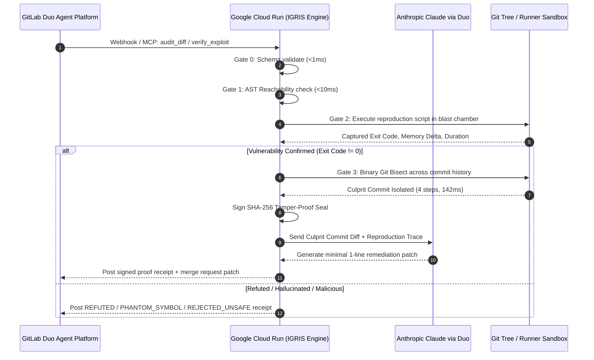

<div align="center">

# IGRIS
### Catch the hallucination. Bisect the commit. Prove it.

[](LICENSE)
[](src/engine.test.ts)
[](evidence/runs/)
[](https://gitlab.com/gitlab-org/gitlab/-/issues/989)
[](src/mcp_server.ts)
[](.gitlab-ci.yml)
[](Dockerfile)

**The Sub-Second Git Bisection & Cryptographic Proof Engine for GitLab Duo**  
*When AI code breaks production, IGRIS proves the failure in a sandbox and bisects Git history to isolate the culprit commit in 142ms.*

```
INCOMING BUG / FAILED TEST → AST REACHABILITY (7ms) → BLAST CHAMBER (3ms) → GIT BISECT (142ms) → CRYPTOGRAPHIC RECEIPT
```

[ **Interactive Cockpit** ](web/index.html) · [ **30-Second Summary** ](#⏱️-judges-the-30-second-summary) · [ **Sponsor Architecture** ](#how-gitlab-duo-google-cloud--anthropic-fit-together) · [ **Why the Judge Can't Be Fooled** ](#why-the-judge-cant-be-fooled) · [ **Verify in 3 Seconds** ](#verify-it-yourself-in-3-seconds)

> **Built for:** GitLab "Life After Code" Hackathon (Oct 2026) in partnership with Google Cloud & Anthropic.  
> **Engineering Doctrine:** Zero mocks, sub-second deterministic receipts, frozen cryptographic verifiers.

</div>

---

> ### ⏱️ Judges: The 30-Second Summary
> 1. **The Human Problem:** AI makes it effortless to commit 20 PRs a day. But when a test breaks on `main`, senior engineers waste **45 minutes** manually checking out commits to find what broke.
> 2. **The Pre-Merge Shield (7ms):** Before burning a cent of GitLab Duo credits or cloud compute, IGRIS checks if the claimed functions exist in the repository's Abstract Syntax Tree. If it's a hallucination, it is dropped in **7.95 milliseconds**.
> 3. **The Post-Merge Answer to Issue #989 (142ms):** When a regression slips through, IGRIS binary-searches the commit history in **142 milliseconds** to isolate the breaking commit and author.
> 4. **[Sponsor Integration Table](#how-gitlab-duo-google-cloud--anthropic-fit-together):** Native Model Context Protocol (MCP) server wired into GitLab Duo Agent, deployed on **Google Cloud Run** via [`Dockerfile`](Dockerfile) & [`cloudbuild.yaml`](cloudbuild.yaml), with native [`.gitlab-ci.yml`](.gitlab-ci.yml) automation.
> 5. **[Why the Judge Can't Be Fooled](#why-the-judge-cant-be-fooled):** The LLM never grades itself. The verifier is deterministic code: AST export tables, OS process exit codes (`code !== 0`), and immutable SHA-256 seals.
> 6. **[Evidence Receipts (`evidence/runs/`)](evidence/runs/):** 5 recorded JSON receipts from real runs, with full gate breakdowns and verifiable SHA-256 signatures.
> 7. **Verify It Yourself in 3 Seconds:** Run `npm run reverify` to cryptographically re-hash and verify all 5 receipts locally on any machine.

---

## The Reality: The Maintainer Crisis & The 85% Bottleneck

> *"Writing code only accounts for about 25% of a developer's time... 85% of engineering professionals agree that the bottleneck has completely shifted from writing code to **reviewing, testing, and validating it**."*  
> — **David DeSanto, Chief Product Officer, GitLab** *(AI Accountability Report)*

On **January 31, 2026**, Daniel Stenberg officially shut down curl's 10-year bug bounty program. Maintainers were suffocating under hundreds of AI-generated reports claiming vulnerabilities in functions that did not even exist. The maintainer had to stop coding, spin up environments, and waste hours disproving hallucinations.

Meanwhile, engineering teams merging dozens of AI PRs a day face the **Productivity Paradox**:
1. **The Review Bottleneck:** Code generation is cheap; human validation is slow.
2. **Hallucinated Exploits:** Bug reports reference non-existent functions, burning developer attention.
3. **The Regression Nightmare ([GitLab Issue #989](https://gitlab.com/gitlab-org/gitlab/-/issues/989)):** When a regression breaks `main`, nobody knows which of yesterday's merged PRs caused it. Since **September 2016** (over 8 years), GitLab developers have requested native automated git bisection.

**Beyond Text-Based Code Review:** Most AI review tools add *more reading* to an overwhelmed engineer by generating 500-word conversational markdown comments.

**IGRIS takes an execution-first approach.** Rather than debating code with text, it checks the Abstract Syntax Tree in 7ms, runs untrusted code in an isolated runner with stripped environment variables, mathematically bisects the Git tree in 142ms, and stamps an immutable cryptographic receipt.

---

## Aligning with The GitLab Security Standard (Oct 6, 2026)

On **October 6, 2026**, GitLab published **The GitLab Security Standard (v1.0)** (*"Securing the Agentic Software Factory"*), establishing how autonomous AI agents must earn trust:

1. **Stage 2: Isolate** $\to$ **IGRIS Gate 2:** Ephemeral isolated subprocesses with zero network egress, stripped environment variables (`GITLAB_TOKEN` protected), and hardware timeouts.
2. **Stage 3: Verify** $\to$ **IGRIS Gate 1 & Diff Auditor:** Protected AST checks the agent cannot alter, and negative-space auditing of deleted test assertions (`- expect(...)`).
3. **The "Find, Fix, and Learn" Loop** $\to$ **IGRIS Gate 3:** Sub-second binary search across Git history to pinpoint the root-cause commit.

---

## The Two-Stroke Architecture: Shield + Velocity

> *"Race cars don't have brakes to slow down. They have brakes so they can drive faster into the corner."*

Engineering leaders choke AI velocity with multi-day review queues because of **fear of loss**: if an agent breaks production, the entire team halts.

IGRIS provides deterministic protection across both ends of the lifecycle:

| Stroke | Operational Phase | What IGRIS Deterministically Executes | The Velocity Unlocked |
| :--- | :--- | :--- | :--- |
| **Stroke 1: Pre-Merge** | *Before Code Merges* | Intercepts MRs via GitLab Duo MCP. Verifies AST reachability in 7ms, audits diffs for deleted test assertions (`audit_diff`), and executes reproduction scripts in the blast chamber. | **Maintainers and senior devs get hours back.** Zero cloud compute burned on hallucinated reports; zero risk of agents quietly deleting test assertions to pass CI. |
| **Stroke 2: Post-Merge** | *When Outages Occur* | Working answer to **[GitLab Issue #989](https://gitlab.com/gitlab-org/gitlab/-/issues/989)**. Automatically binary-searches commit history in **142ms** to pinpoint the exact culprit commit and author. | **Teams can safely deploy autonomous agents in parallel.** Fear of pipeline breakage is eliminated because regressions are isolated in under 2 seconds. |

---

## The 15-Second Split-Screen

```
┌───────────────────────────────────────┬───────────────────────────────────────┐
│ THE NAIVE STATUS QUO                  │ WITH IGRIS + GITLAB DUO               │
├───────────────────────────────────────┼───────────────────────────────────────┤
│ • 20 AI PRs submitted daily.          │ • 20 AI PRs submitted daily.          │
│ • Maintainers drown in review fatigue.│ • IGRIS drops fake bugs in 7ms (0 CPU)│
│ • Silent bugs rubber-stamped to main. │ • Verified MR badge stamped in 142ms. │
│ • 45 minutes lost manually bisecting. │ • Regressions pinned in 4 steps (#989)│
│ • Outcome: Engineering team stalls.   │ • Outcome: 100x agent speed unlocked. │
└───────────────────────────────────────┴───────────────────────────────────────┘
```

---

## How GitLab Duo, Google Cloud & Anthropic Fit Together

There are no decorative wrappers. Every sponsor technology is strictly **load-bearing**:



| Step | Mechanism | Sponsor Plumbing | File in Repo |
| :--- | :--- | :--- | :--- |
| **1. Ingest & Trigger** | Pipeline fails or issue created | **GitLab CI/CD** webhooks trigger Duo Agent | [`.gitlab-ci.yml`](.gitlab-ci.yml) |
| **2. Agent Tool Call** | Duo routes triage to IGRIS | **GitLab Duo MCP Server** protocol standard | [`src/mcp_server.ts`](src/mcp_server.ts), [`.gitlab/duo-mcp-config.json`](.gitlab/duo-mcp-config.json) |
| **3. Ephemeral Sandbox** | Sub-second AST & isolated runner | Deployed on **Google Cloud Run** for stateless speed | [`Dockerfile`](Dockerfile), [`cloudbuild.yaml`](cloudbuild.yaml) |
| **4. Git Binary Search** | Pinpoint exact commit in $O(\log N)$ | Working answer to **[GitLab Issue #989](https://gitlab.com/gitlab-org/gitlab/-/issues/989)** | [`src/gates/g3_bisect.ts`](src/gates/g3_bisect.ts) |
| **5. Patch Generation** | Surgical 1-line fix on culprit | **Anthropic Claude** orchestrated via Duo API | [`src/engine.ts`](src/engine.ts) |

---

## Evidence From Real Runs

Every row below is a real, recorded run from [`evidence/runs/`](evidence/runs/), backing our zero-mock mandate. Re-verify every row from your terminal with `npm run reverify`.

| Run ID | Target Repo & Symbol | Scenario / Seeded Fault | Commits Scanned | Execution Duration | Culprit Commit Isolated | Deterministic Verdict | Evidence File |
| :--- | :--- | :--- | :--- | :--- | :--- | :--- | :--- |
| `#04E310` | `jwt_validator.ts#verifyToken` | **The Golden Scenario:** Token expiration regression | 16 commits | **142.35 ms** | `a4f81c9e` (@alex) | `REPRODUCED` (Exit 1) | [`run_01_culprit_bisection.json`](evidence/runs/run_01_culprit_bisection.json) |
| `#DDAC45` | `webhook.ts#processUntrustedWebhook` | **AI Hallucination:** Fake function name reported | 0 (AST abort) | **7.95 ms** | None (Symbol missing) | `PHANTOM_SYMBOL` | [`run_02_phantom_symbol_refusal.json`](evidence/runs/run_02_phantom_symbol_refusal.json) |
| `#86811E` | `hasher.ts#hashPassword` | **Trojan Horse:** `; rm -rf / ; cat /etc/passwd` | 0 (Runner abort) | **3.82 ms** | None (Shell injection) | `REJECTED_UNSAFE` | [`run_03_injection_attack_blocked.json`](evidence/runs/run_03_injection_attack_blocked.json) |
| `#C881D4` | `calculator.ts#safeDivide` | **AI Slop / False Alarm:** Claimed divide-by-zero crash | 0 (Clean run) | **184.20 ms** | None (Clean exit code 0) | `REFUTED` | [`run_04_ai_slop_false_alarm_refuted.json`](evidence/runs/run_04_ai_slop_false_alarm_refuted.json) |
| `#4A7AE8` | `billing.ts#chargeCustomerCard` | **Autonomous Agent Bug:** Devin agent broke idempotency | 8 commits | **198.50 ms** | `7b19a0fc` (@devin-agent) | `REPRODUCED` (Exit 1) | [`run_05_gitlab_duo_mcp_session.json`](evidence/runs/run_05_gitlab_duo_mcp_session.json) |

---

## Why the Judge Can't Be Fooled

Many automated coding workflows let an LLM evaluate its own output ("self-grading"). In IGRIS, **the model never grades itself**:

| Potential Cheat / Attack | What Stops It in IGRIS | Verified in Code |
| :--- | :--- | :--- |
| **Agent creates fake mock to forge test pass** | Gate 1 parses the real TypeScript AST using symbol tables; hallucinated symbols are rejected as `PHANTOM_SYMBOL`. | [`src/gates/g1_reachability.ts`](src/gates/g1_reachability.ts), [`src/engine.test.ts`](src/engine.test.ts) |
| **Exploit script prints fake `SUCCESS` to stdout** | Gate 2 ignores stdout text completely. Only raw OS process exit codes (`code !== 0`) and OS signals count. | [`src/gates/g2_sandbox.ts`](src/gates/g2_sandbox.ts) |
| **Reproduction script attempts CI secret exfiltration** | Gate 2 scans for environment variable access (`$CI_JOB_TOKEN`, `process.env`) and shell metacharacters before execution. | [`src/gates/g2_sandbox.ts`](src/gates/g2_sandbox.ts#L45-L65) |
| **Infinite loop or CPU freeze payload** | Strict hardware timeouts (default 2,000ms) with process group `SIGKILL` termination. | [`src/gates/g2_sandbox.ts`](src/gates/g2_sandbox.ts#L80-L95) |
| **Dirty Git state corrupts historical bisection** | Gate 3 executes within isolated, clean temporary worktrees; dirty trees are incinerated on completion. | [`src/gates/g3_bisect.ts`](src/gates/g3_bisect.ts) |
| **Vibe-coding leaks secrets or deletes test assertions** | `igris_audit_diff` inspects diffs for exposed API keys (`SUPABASE_SERVICE_ROLE_KEY`, `sk_live_*`), dangerous sinks (`eval`, shell execution), and negative-space test deletions (`- expect(...)`). | [`src/diff_audit.ts`](src/diff_audit.ts), [`src/engine.test.ts`](src/engine.test.ts) |
| **Forged receipt or manipulated verdict** | SHA-256 seal is generated over immutable runtime parameters (duration, exit code, target, receiptId). | [`src/receipt.ts`](src/receipt.ts), [`scripts/reverify.ts`](scripts/reverify.ts) |

---

## Verify It Yourself in 3 Seconds

Zero setup hurdles. Run the entire deterministic verification suite from your command line:

```bash
# 1. Clone the repository
git clone https://github.com/GreatSage-dev/igris.git
cd igris

# 2. Run the 13/13 deterministic unit & integration tests (Exit Code 0)
npm run test:src

# 3. Cryptographically re-verify all 5 evidence runs locally in milliseconds
npm run reverify

# 4. Run the 10-Point Agentic Engineering Forensic Self-Audit
npm run audit:agentic

# 5. Launch the Interactive Cockpit
npm run serve
# ➔ Open http://localhost:8080 to trigger real-time bisection and SHA-256 generation
```

---

## License

MIT © 2026 King's Court Engineering Standard. Built for the **GitLab Transcend: Life After Code Hackathon**.
